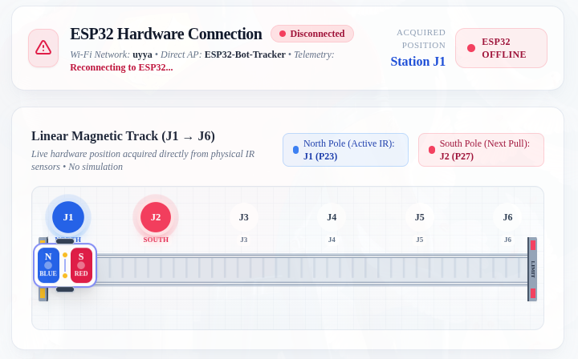
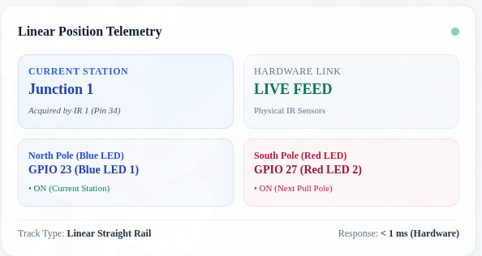
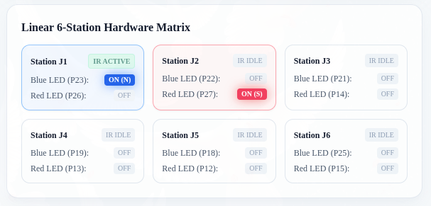

# ESP32 6-Junction Linear Magnetic Track & Bot Tracker

A real-time hardware positioning and magnetic mover simulation system powered by an **ESP32**, **6 IR obstacle sensors**, **12 indicator LEDs** (6 Blue North Pole + 6 Red South Pole), and an animated, embedded **Web UI Dashboard**.

---

## 🚀 Overview



The system monitors a 6-junction linear track where a magnetic cart/bot moves. As the physical bot passes over each IR sensor:
- The corresponding **Blue LED (North Pole)** lights up at the detected junction.
- The next **Red LED (South Pole)** lights up at `junction + 1` to indicate the forward magnetic pull.
- The onboard ESP32 web server serves a live, animated web dashboard tracking the cart's position across junctions `J1` through `J6` in real time with zero simulation delay.

---

## 🔌 Hardware Pin Mapping

### IR Obstacle Sensors (Active LOW)
| Station | GPIO Pin | Function |
| :---: | :---: | :---: |
| **J1** | `GPIO 34` | IR Sensor 1 |
| **J2** | `GPIO 35` | IR Sensor 2 |
| **J3** | `GPIO 36` (VP) | IR Sensor 3 |
| **J4** | `GPIO 39` (VN) | IR Sensor 4 |
| **J5** | `GPIO 32` | IR Sensor 5 |
| **J6** | `GPIO 33` | IR Sensor 6 |

### Blue LEDs (North Pole - Detected Position)
| Station | GPIO Pin | Function |
| :---: | :---: | :---: |
| **J1** | `GPIO 23` | Blue LED 1 |
| **J2** | `GPIO 22` | Blue LED 2 |
| **J3** | `GPIO 21` | Blue LED 3 |
| **J4** | `GPIO 19` | Blue LED 4 |
| **J5** | `GPIO 18` | Blue LED 5 |
| **J6** | `GPIO 25` | Blue LED 6 |

### Red LEDs (South Pole - Next Forward Junction)
| Station | GPIO Pin | Function |
| :---: | :---: | :---: |
| **J1** | `GPIO 26` | Red LED 1 |
| **J2** | `GPIO 27` | Red LED 2 |
| **J3** | `GPIO 14` | Red LED 3 |
| **J4** | `GPIO 13` | Red LED 4 |
| **J5** | `GPIO 12` | Red LED 5 |
| **J6** | `GPIO 15` | Red LED 6 |

---

## 🌐 Web Dashboard & Networking

The ESP32 runs in dual Wi-Fi mode (**WIFI_AP_STA**):
1. **Local Wi-Fi Network**: Connects to the configured SSID/Password and provides an IP address (e.g., `http://172.20.10.4` or `http://192.168.x.x`).
2. **Direct Access Point (Fallback)**:
   - **SSID**: `ESP32-Bot-Tracker`
   - **Password**: `Shamball`
   - **AP Dashboard URL**: `http://192.168.4.1`

### Dashboard Features
- **Real-Time Linear Track**: Smoothly animated bot carriage traversing a straight rail between stations `J1` and `J6`.
- **Live Hardware Connection Tab**: Displays live connection status with pulsing indicators.
- **Linear Position Telemetry**: Live readout of the active station, hardware link status, and active North/South pole LEDs.
- **Hardware Telemetry Matrix**: Displays real-time states for each IR input and active/inactive LED drivers across all 6 stations.

#### 📊 Live Telemetry & Matrix Views
| Linear Position Telemetry | Linear 6-Station Hardware Matrix |
| :---: | :---: |
|  |  |

---

## 🛠️ Build and Flash Instructions

This project is configured for **PlatformIO**.

### 1. Build Firmware
```bash
pio run
```

### 2. Upload to ESP32
```bash
pio run --target upload
```

### 3. Open Serial Monitor
```bash
pio device monitor -b 115200
```
